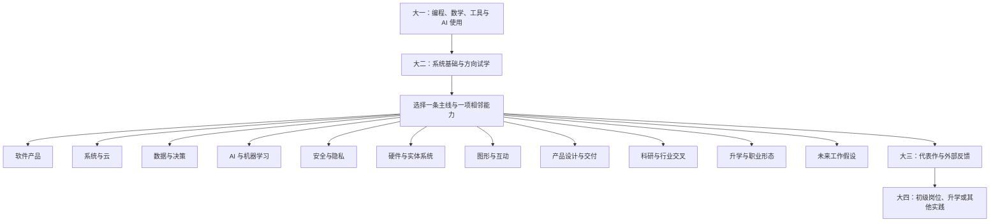

# AI 时代计算机学生发展路线

从大一共同基础到初级岗位、研究训练及长期职业发展。以 [roadmap.sh](https://roadmap.sh/roadmaps) 的角色目录与节点形式为参考，使用 **Markdown + Mermaid**，直接在 GitHub 阅读，无需网站、前端构建或服务部署。

**观察日期：2026-11-21。默认情境：国内四年制计算机本科；学校课程、地区与选拔规则需按个人目标调整。**

## 从哪里开始

1. 阅读[四年共同主干](docs/foundation.md)，按能力而非年级机械推进。
2. 在下面的分类中选择一条主线，打开该方向的独立路线图。
3. 阅读[AI 时代新增分工与原路线修改](docs/ai-era.md)，不要只把 AI 加成一门选修课。
4. 用[作品集与入口验收](docs/evidence-and-entry.md)检查进展；用[个人计划模板](templates/personal-plan.md)落实到当前学期。

## 发展方向总图



## 路线目录

共 **115 条方向与发展路径、11 个分类**，另含共同基础。数量是本仓库的编排结果，不是就业市场岗位数量；相关岗位可能在公司内合并。

| 分类 | 条目 | 示例 |
| --- | ---: | --- |
| [软件产品](categories/software.md) | 11 | Web 前端、后端开发、全栈／产品工程、Android 开发等 |
| [系统与云](categories/systems.md) | 12 | DevOps／平台工程、SRE／可靠性工程、云计算／云平台研发、网络工程／网络研发等 |
| [数据与决策](categories/data.md) | 8 | 数据工程、分析工程／数仓建模、数据分析／BI、数据科学／因果推断等 |
| [AI 与机器学习](categories/ai.md) | 22 | 机器学习工程、AI 应用工程、Agent／智能体工程、FDE／行业 AI 交付等 |
| [安全与隐私](categories/security.md) | 9 | 应用安全／安全研发、云安全／IAM、安全运营／检测响应、渗透测试／红队等 |
| [硬件与实体系统](categories/hardware.md) | 9 | 嵌入式／固件、驱动／BSP／嵌入式 Linux、FPGA／RTL 设计、芯片验证／EDA等 |
| [图形与互动](categories/graphics.md) | 6 | 游戏玩法／客户端、游戏服务器、游戏引擎／图形渲染、技术美术／程序化内容等 |
| [产品设计与交付](categories/product.md) | 13 | 产品经理／技术产品、AI 产品经理、交互／UX／产品设计、用户研究／HCI 研究等 |
| [科研与行业交叉](categories/research.md) | 9 | 理论计算机／算法研究、形式化方法／程序分析、科学计算／AI for Science、生物信息／计算医学等 |
| [升学与职业形态](categories/development.md) | 8 | 国内升学／考研保研、海外升学／研究申请、高校／科研机构、公共部门／事业单位信息化等 |
| [未来工作假设](categories/future.md) | 8 | 智能体可靠性与运行治理、AI 生成软件验证、智能体记忆与数据授权、多智能体运行治理专岗等 |

也可以查看[全部路线索引](docs/all-routes.md)，或重点看[未来工作假设](docs/future.md)。

## 每条路线包含什么

- 先修知识与方向入口。
- 节点图、阶段学习主题与建议窗口。
- AI 时代建议增加、保留、减少的训练，以及风险。
- 代表项目、可检查的能力验收与后续发展。
- 起步课程或资料，以及事实、建议和预测的边界。

## 四种不同性质的条目

| 标记 | 本仓库条目数 | 含义 |
| --- | ---: | --- |
| 现有 | 94 | 已存在的岗位族或相邻工作方向；不表示所有地区都大量招聘 |
| 新兴分工 | 5 | 已有工作内容或招聘实例；独立职称和组织分工未必统一 |
| 发展路径 | 8 | 升学、科研、公共部门、创业、自由职业等路径，不是单个岗位 |
| 未来假设 | 8 | 对工作分工可能扩大的有条件判断；不是确定岗位预测 |

**“当前及未来所有岗位”无法可靠穷尽。** 本仓库覆盖主要技术族、相邻职业、行业交叉和职业形态，并提供可扩展结构。它不把工具名当独立职业，不把资深职级当本科默认出口，也不承诺按表学习即可录用。

## AI 时代的核心修改

共同基础继续保留；训练重点增加任务规格、上下文、结果验证、数据来源、权限、成本与交付责任。减少的是机械重复，不是编程、数学和系统理解。AI 应用、模型研究、训练/推理系统、评测与安全采用不同路线。

roadmap.sh 当下已包含 AI 工程、推理、MLOps、AI 红队、Agent、上下文及 FDE 等相关内容，不能笼统说这些都在其覆盖之外。本仓库额外展开训练环境、执行沙箱、人类反馈数据等分工，并在每条旧路线中加入具体调整。见[逐项对照](docs/ai-era.md)。

## 资料与使用

主要依据包括 [CS2023](https://csed.acm.org/final-report/)、[CS 自学指南](https://csdiy.wiki/)、[MIT Missing Semester](https://missing.csail.mit.edu/)、[Stanford CS336](https://cs336.stanford.edu/)、[CMU Deep Learning Systems](https://dlsyscourse.org/)、[Hugging Face Learn](https://huggingface.co/learn)、[NIST NICE](https://www.nist.gov/itl/applied-cybersecurity/nice/nice-framework-resource-center/resources/occupations-jobs-and-work) 与 [OWASP GenAI](https://genai.owasp.org/llm-top-10/)。招聘资料只作为岗位存在的实例，不能外推整个中国就业市场。[完整来源与核验范围](docs/sources.md)。

本仓库不需要 Web 部署：上传 GitHub 仓库即可阅读；GitHub 支持 Mermaid 图表。上传步骤见[GitHub 发布说明](docs/github-publishing.md)。当前交付的是可上传的项目文件，不代表已经创建远程仓库。

## 维护

`data/catalog.json` 是路线内容源；`data/metadata.json` 保存 AI 调整与资料。修改后执行：

```bash
python tools/build.py
python tools/validate.py
```

依赖：Python 3.10+，仅标准库。校验只检查数据与仓库内部一致性，不自动证明职业判断、教学有效性或外部链接永远有效。

[贡献说明](CONTRIBUTING.md) · [更新记录](CHANGELOG.md) · [MIT License](LICENSE)
