# AI 与机器学习

[返回总览](../README.md) · [先看共同基础](../docs/foundation.md)

本类 22 条路线。下面的节点是选择分支，不需要全部学习。

```mermaid
flowchart TB
  F["AI 与机器学习"]
  F --> R0["机器学习工程"]
  F --> R1["AI 应用工程"]
  F --> R2["Agent／智能体工程"]
  F --> R3["FDE／行业 AI 交付"]
  F --> R4["NLP／语言模型预训练"]
  F --> R5["模型后训练／偏好学习"]
  F --> R6["强化学习／训练环境"]
  F --> R7["计算机视觉"]
  F --> R8["语音／音频算法"]
  F --> R9["多模态／生成模型"]
  F --> R10["训练系统／AI 框架"]
  F --> R11["推理工程／模型优化"]
  F --> R12["MLOps／机器学习平台"]
  F --> R13["AI 评测／行为评估"]
  F --> R14["AI 对齐／可解释性"]
  F --> R15["AI 数据／合成数据工程"]
  F --> R16["端侧 AI／模型压缩"]
  F --> R17["RL 训练环境／研究工程"]
  F --> R18["AI 执行沙箱／工具平台"]
  F --> R19["上下文／记忆工程"]
  F --> R20["人类反馈／标注运营"]
  F --> R21["AI 治理／模型风险"]
```

| 路线 | 类型 | 入口判断（建议） |
| --- | --- | --- |
| [机器学习工程](../roadmaps/ai/mleng.md) | 现有 | 本科有入口，能力要求因团队而异 |
| [AI 应用工程](../roadmaps/ai/aiapp.md) | 现有 | 本科可争取初级岗 |
| [Agent／智能体工程](../roadmaps/ai/agents.md) | 新兴分工 | 本科可争取初级岗，职称不统一 |
| [FDE／行业 AI 交付](../roadmaps/ai/fde.md) | 现有 | 本科入口因团队而异 |
| [NLP／语言模型预训练](../roadmaps/ai/llm.md) | 现有 | 研究目标建议研究生延伸 |
| [模型后训练／偏好学习](../roadmaps/ai/posttrain.md) | 现有 | 研究目标建议研究生延伸 |
| [强化学习／训练环境](../roadmaps/ai/rl.md) | 现有 | 研究目标建议研究生延伸 |
| [计算机视觉](../roadmaps/ai/cv.md) | 现有 | 本科有入口，研究目标宜深造 |
| [语音／音频算法](../roadmaps/ai/audio.md) | 现有 | 研究目标建议研究生延伸 |
| [多模态／生成模型](../roadmaps/ai/multimodal.md) | 现有 | 研究目标建议研究生延伸 |
| [训练系统／AI 框架](../roadmaps/ai/mlsystems.md) | 现有 | 本科可争取初级岗，要求较深 |
| [推理工程／模型优化](../roadmaps/ai/inference.md) | 现有 | 本科可争取初级岗，要求较深 |
| [MLOps／机器学习平台](../roadmaps/ai/mlops.md) | 现有 | 本科入口因团队而异 |
| [AI 评测／行为评估](../roadmaps/ai/evals.md) | 现有 | 工程和研究入口不同 |
| [AI 对齐／可解释性](../roadmaps/ai/alignment.md) | 现有 | 研究目标建议研究生延伸 |
| [AI 数据／合成数据工程](../roadmaps/ai/aidata.md) | 现有 | 本科入口因团队而异 |
| [端侧 AI／模型压缩](../roadmaps/ai/edgeai.md) | 现有 | 本科可争取初级岗 |
| [RL 训练环境／研究工程](../roadmaps/ai/rlenv.md) | 新兴分工 | 已有招聘实例，常要求较强工程基础 |
| [AI 执行沙箱／工具平台](../roadmaps/ai/sandbox.md) | 新兴分工 | 已有招聘实例，偏系统与安全 |
| [上下文／记忆工程](../roadmaps/ai/context.md) | 新兴分工 | 已有工作内容，独立职称不统一 |
| [人类反馈／标注运营](../roadmaps/ai/humanfeedback.md) | 现有 | 本科入口因团队而异 |
| [AI 治理／模型风险](../roadmaps/ai/aigovernance.md) | 现有 | 需技术、业务与地区规则知识 |
