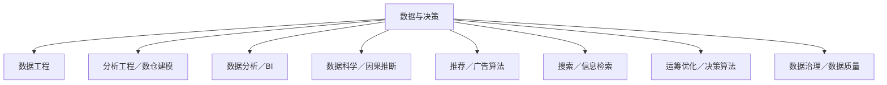

# 数据与决策

[返回总览](../README.md) · [先看共同基础](../docs/foundation.md)

本类 8 条路线。下面的节点是选择分支，不需要全部学习。

| 路线 | 类型 | 入口判断（建议） |
| --- | --- | --- |
| [数据工程](../roadmaps/data/dataeng.md) | 现有 | 本科可争取初级岗 |
| [分析工程／数仓建模](../roadmaps/data/analyticseng.md) | 现有 | 本科入口因团队而异 |
| [数据分析／BI](../roadmaps/data/analyst.md) | 现有 | 本科可争取初级岗 |
| [数据科学／因果推断](../roadmaps/data/datascience.md) | 现有 | 研究型目标建议深造 |
| [推荐／广告算法](../roadmaps/data/recommend.md) | 现有 | 本科有入口，部分团队偏研究 |
| [搜索／信息检索](../roadmaps/data/search.md) | 现有 | 本科有入口，部分团队偏研究 |
| [运筹优化／决策算法](../roadmaps/data/optimization.md) | 现有 | 研究型目标建议深造 |
| [数据治理／数据质量](../roadmaps/data/governance.md) | 现有 | 本科入口因团队而异 |
