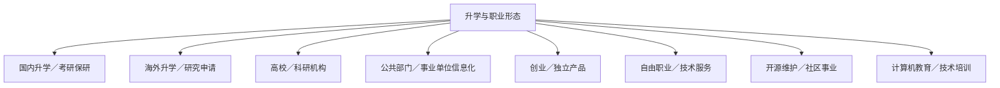

# 升学与职业形态

[返回总览](../README.md) · [先看共同基础](../docs/foundation.md)

本类 8 条路线。下面的节点是选择分支，不需要全部学习。

| 路线 | 类型 | 入口判断（建议） |
| --- | --- | --- |
| [国内升学／考研保研](../roadmaps/development/grad.md) | 发展路径 | 选拔条件以目标院校当年规则为准 |
| [海外升学／研究申请](../roadmaps/development/abroad.md) | 发展路径 | 费用、签证和申请规则依地区变化 |
| [高校／科研机构](../roadmaps/development/academia.md) | 发展路径 | 通常经研究生与博士，岗位规则各异 |
| [公共部门／事业单位信息化](../roadmaps/development/public.md) | 发展路径 | 以地区与单位当年招录为准 |
| [创业／独立产品](../roadmaps/development/startup.md) | 发展路径 | 收入与风险不确定 |
| [自由职业／技术服务](../roadmaps/development/freelance.md) | 发展路径 | 需业务、合同与现金流能力 |
| [开源维护／社区事业](../roadmaps/development/opensource.md) | 发展路径 | 可与受雇工作并行，收入无保证 |
| [计算机教育／技术培训](../roadmaps/development/education.md) | 发展路径 | 任教资格与岗位要求因地区而异 |
