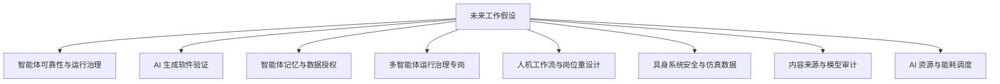

# 未来工作假设

[返回总览](../README.md) · [先看共同基础](../docs/foundation.md)

本类 8 条路线。下面的节点是选择分支，不需要全部学习。

| 路线 | 类型 | 入口判断（建议） |
| --- | --- | --- |
| [智能体可靠性与运行治理](../roadmaps/future/agentreliability.md) | 未来假设 | 工作内容可能扩大，独立职称未确定 |
| [AI 生成软件验证](../roadmaps/future/aiverify.md) | 未来假设 | 已有相关工作，是否独立成岗不确定 |
| [智能体记忆与数据授权](../roadmaps/future/memory.md) | 未来假设 | 取决于长期记忆和跨应用采用 |
| [多智能体运行治理专岗](../roadmaps/future/multiagent.md) | 未来假设 | 多智能体研究岗已存在，独立治理专岗尚不确定 |
| [人机工作流与岗位重设计](../roadmaps/future/humanai.md) | 未来假设 | 已有咨询/HCI 工作，分工可能变化 |
| [具身系统安全与仿真数据](../roadmaps/future/embodiedsafety.md) | 未来假设 | 取决于实体部署、责任和成本 |
| [内容来源与模型审计](../roadmaps/future/provenance.md) | 未来假设 | 已有相关工作，规模与名称不确定 |
| [AI 资源与能耗调度](../roadmaps/future/aicompute.md) | 未来假设 | 优化已存在，专门分工可能扩大 |
