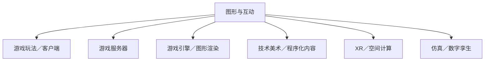

# 图形与互动

[返回总览](../README.md) · [先看共同基础](../docs/foundation.md)

本类 6 条路线。下面的节点是选择分支，不需要全部学习。

| 路线 | 类型 | 入口判断（建议） |
| --- | --- | --- |
| [游戏玩法／客户端](../roadmaps/graphics/gameplay.md) | 现有 | 本科可争取初级岗 |
| [游戏服务器](../roadmaps/graphics/gameserver.md) | 现有 | 本科可争取初级岗 |
| [游戏引擎／图形渲染](../roadmaps/graphics/engine.md) | 现有 | 本科可争取初级岗，要求较深 |
| [技术美术／程序化内容](../roadmaps/graphics/ta.md) | 现有 | 需艺术与工程双重作品 |
| [XR／空间计算](../roadmaps/graphics/xr.md) | 现有 | 本科入口因团队而异 |
| [仿真／数字孪生](../roadmaps/graphics/simulation.md) | 现有 | 需物理或行业基础 |
