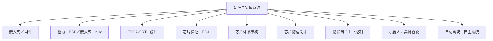

# 硬件与实体系统

[返回总览](../README.md) · [先看共同基础](../docs/foundation.md)

本类 9 条路线。下面的节点是选择分支，不需要全部学习。

| 路线 | 类型 | 入口判断（建议） |
| --- | --- | --- |
| [嵌入式／固件](../roadmaps/hardware/embedded.md) | 现有 | 本科可争取初级岗 |
| [驱动／BSP／嵌入式 Linux](../roadmaps/hardware/driver.md) | 现有 | 本科可争取初级岗 |
| [FPGA／RTL 设计](../roadmaps/hardware/fpga.md) | 现有 | 需补电子与硬件课程 |
| [芯片验证／EDA](../roadmaps/hardware/chipverify.md) | 现有 | 需补电子与硬件课程 |
| [芯片体系结构](../roadmaps/hardware/chiparch.md) | 现有 | 长期目标，需深厚硬件训练 |
| [芯片物理设计](../roadmaps/hardware/physical.md) | 现有 | 需补电路与微电子课程 |
| [物联网／工业控制](../roadmaps/hardware/iot.md) | 现有 | 需补通信、控制和领域基础 |
| [机器人／具身智能](../roadmaps/hardware/robotics.md) | 现有 | 工程与研究路线分开 |
| [自动驾驶／自主系统](../roadmaps/hardware/autonomy.md) | 现有 | 部分算法目标宜深造 |
