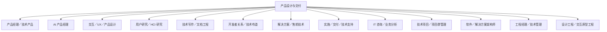

# 产品设计与交付

[返回总览](../README.md) · [先看共同基础](../docs/foundation.md)

本类 13 条路线。下面的节点是选择分支，不需要全部学习。

| 路线 | 类型 | 入口判断（建议） |
| --- | --- | --- |
| [产品经理／技术产品](../roadmaps/product/pm.md) | 现有 | 本科可争取初级岗 |
| [AI 产品经理](../roadmaps/product/aipm.md) | 现有 | 本科入口因团队而异 |
| [交互／UX／产品设计](../roadmaps/product/ux.md) | 现有 | 需设计作品集 |
| [用户研究／HCI 研究](../roadmaps/product/uxresearch.md) | 现有 | 研究型目标建议深造 |
| [技术写作／文档工程](../roadmaps/product/writer.md) | 现有 | 本科可争取初级岗 |
| [开发者关系／技术布道](../roadmaps/product/devrel.md) | 现有 | 本科入口因团队而异 |
| [解决方案／售前技术](../roadmaps/product/solutions.md) | 现有 | 本科入口因团队而异 |
| [实施／交付／技术支持](../roadmaps/product/implementation.md) | 现有 | 本科可争取初级岗 |
| [IT 咨询／业务分析](../roadmaps/product/consulting.md) | 现有 | 需业务与表达训练 |
| [技术项目／项目群管理](../roadmaps/product/tpm.md) | 现有 | 通常为有交付经验后的延伸 |
| [软件／解决方案架构师](../roadmaps/product/architect.md) | 现有 | 长期发展目标，非本科默认出口 |
| [工程经理／技术管理](../roadmaps/product/em.md) | 现有 | 长期发展目标，需团队经验 |
| [设计工程／交互原型工程](../roadmaps/product/designeng.md) | 现有 | 需设计与代码作品 |
