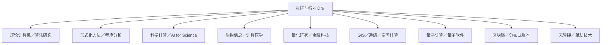

# 科研与行业交叉

[返回总览](../README.md) · [先看共同基础](../docs/foundation.md)

本类 9 条路线。下面的节点是选择分支，不需要全部学习。

| 路线 | 类型 | 入口判断（建议） |
| --- | --- | --- |
| [理论计算机／算法研究](../roadmaps/research/theory.md) | 现有 | 研究生与博士延伸 |
| [形式化方法／程序分析](../roadmaps/research/formal.md) | 现有 | 研究型目标建议深造 |
| [科学计算／AI for Science](../roadmaps/research/science.md) | 现有 | 需领域基础，常延伸研究生 |
| [生物信息／计算医学](../roadmaps/research/bio.md) | 现有 | 需生物或医学训练 |
| [量化研究／金融科技](../roadmaps/research/quant.md) | 现有 | 研究和工程入口不同 |
| [GIS／遥感／空间计算](../roadmaps/research/gis.md) | 现有 | 需地理与空间数据基础 |
| [量子计算／量子软件](../roadmaps/research/quantum.md) | 现有 | 研究路线，需物理数学延伸 |
| [区块链／分布式账本](../roadmaps/research/blockchain.md) | 现有 | 需核对地区合规与岗位 |
| [无障碍／辅助技术](../roadmaps/research/accessibility.md) | 现有 | 需用户研究与相关标准 |
