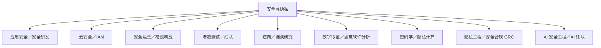

# 安全与隐私

[返回总览](../README.md) · [先看共同基础](../docs/foundation.md)

本类 9 条路线。下面的节点是选择分支，不需要全部学习。

| 路线 | 类型 | 入口判断（建议） |
| --- | --- | --- |
| [应用安全／安全研发](../roadmaps/security/appsec.md) | 现有 | 本科可争取初级岗 |
| [云安全／IAM](../roadmaps/security/cloudsec.md) | 现有 | 本科入口因团队而异 |
| [安全运营／检测响应](../roadmaps/security/soc.md) | 现有 | 本科可争取初级岗 |
| [渗透测试／红队](../roadmaps/security/pentest.md) | 现有 | 本科入口因团队而异 |
| [逆向／漏洞研究](../roadmaps/security/reverse.md) | 现有 | 本科可争取初级岗，要求较深 |
| [数字取证／恶意软件分析](../roadmaps/security/forensics.md) | 现有 | 本科入口因团队而异 |
| [密码学／隐私计算](../roadmaps/security/crypto.md) | 现有 | 研究目标建议研究生延伸 |
| [隐私工程／安全合规 GRC](../roadmaps/security/privacy.md) | 现有 | 本科入口因组织与地区而异 |
| [AI 安全工程／AI 红队](../roadmaps/security/aisec.md) | 新兴分工 | 本科入口因团队而异 |
