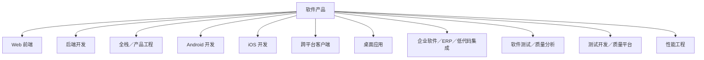

# 软件产品

[返回总览](../README.md) · [先看共同基础](../docs/foundation.md)

本类 11 条路线。下面的节点是选择分支，不需要全部学习。

| 路线 | 类型 | 入口判断（建议） |
| --- | --- | --- |
| [Web 前端](../roadmaps/software/frontend.md) | 现有 | 本科可争取初级岗 |
| [后端开发](../roadmaps/software/backend.md) | 现有 | 本科可争取初级岗 |
| [全栈／产品工程](../roadmaps/software/fullstack.md) | 现有 | 本科可争取初级岗 |
| [Android 开发](../roadmaps/software/android.md) | 现有 | 本科可争取初级岗 |
| [iOS 开发](../roadmaps/software/ios.md) | 现有 | 本科可争取初级岗 |
| [跨平台客户端](../roadmaps/software/crossplatform.md) | 现有 | 本科可争取初级岗 |
| [桌面应用](../roadmaps/software/desktop.md) | 现有 | 本科可争取初级岗 |
| [企业软件／ERP／低代码集成](../roadmaps/software/enterprise.md) | 现有 | 本科可争取初级岗 |
| [软件测试／质量分析](../roadmaps/software/qa.md) | 现有 | 本科可争取初级岗 |
| [测试开发／质量平台](../roadmaps/software/sdet.md) | 现有 | 本科可争取初级岗 |
| [性能工程](../roadmaps/software/performance.md) | 现有 | 本科入口因团队而异 |
