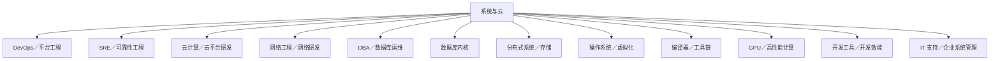

# 系统与云

[返回总览](../README.md) · [先看共同基础](../docs/foundation.md)

本类 12 条路线。下面的节点是选择分支，不需要全部学习。

| 路线 | 类型 | 入口判断（建议） |
| --- | --- | --- |
| [DevOps／平台工程](../roadmaps/systems/devops.md) | 现有 | 本科可争取初级岗 |
| [SRE／可靠性工程](../roadmaps/systems/sre.md) | 现有 | 本科入口因团队而异 |
| [云计算／云平台研发](../roadmaps/systems/cloud.md) | 现有 | 本科可争取初级岗 |
| [网络工程／网络研发](../roadmaps/systems/network.md) | 现有 | 本科可争取初级岗 |
| [DBA／数据库运维](../roadmaps/systems/dba.md) | 现有 | 本科入口因团队而异 |
| [数据库内核](../roadmaps/systems/dbkernel.md) | 现有 | 本科可争取初级岗，要求较深 |
| [分布式系统／存储](../roadmaps/systems/storage.md) | 现有 | 本科可争取初级岗，要求较深 |
| [操作系统／虚拟化](../roadmaps/systems/os.md) | 现有 | 本科可争取初级岗，要求较深 |
| [编译器／工具链](../roadmaps/systems/compiler.md) | 现有 | 本科可争取初级岗，要求较深 |
| [GPU／高性能计算](../roadmaps/systems/hpc.md) | 现有 | 本科可争取初级岗，要求较深 |
| [开发工具／开发效能](../roadmaps/systems/devtools.md) | 现有 | 本科可争取初级岗 |
| [IT 支持／企业系统管理](../roadmaps/systems/itsupport.md) | 现有 | 本科可争取初级岗 |
