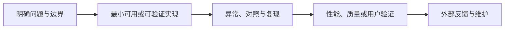

# 求职、升学与作品集：怎样验收能力

[返回总览](../README.md) · [全部路线](all-routes.md)

课程完成、刷题数量、证书和仓库星数都不能单独证明岗位能力。把每条路线的验收点落实为可检查证据。

## 四层证据

| 层次 | 应展示的内容 | 常见误判 |
| --- | --- | --- |
| 基础 | 解释机制、完成必要推导、独立调试 | 看过视频等于掌握 |
| 方向实现 | 可复现代码/实验、方法和失败案例 | 运行成功一次等于可靠 |
| 协作交付 | 阅读已有工作、接受审查、写文档、交接 | 所有东西从零写才有价值 |
| 外部反馈 | 导师、用户、实习或开源审查 | 自己给自己的项目打分即可 |

## 一份代表作怎样迭代

工程代表作记录需求、架构、测试、运行条件、性能和回滚；研究代表作记录问题、假设、数据划分、基线、消融、随机性和局限；产品与设计案例记录研究证据、备选方案、取舍、验证与迭代。所有类型说明个人贡献。

AI 应用另应给出：简单方案基线、任务集、评分方法、失败分组、权限、延迟与成本。研究或推理优化不能只展示聊天界面。

## 应聘初级工程岗

- 能解释主线基础，并完成与岗位相关的现场实现或排障。
- 能在已有代码库中修复有边界的问题，不只熟悉自己的演示项目。
- 简历中的性能、效果和用户数字都有测量口径；没有数据就不编造。
- 能说明 AI 帮助了什么、自己核验了什么、仍有什么限制。
- 根据目标地区与团队核对当年职位要求，不把本仓库的建议当硬门槛。

## 进入研究训练

- 先修足以理解目标论文的方法，而不只是摘要。
- 能复现小规模基线并解释偏差，提出可检验的问题。
- 数据、计算预算和实验条件可行，知道何时需要导师与合作。
- 材料区分个人贡献、团队贡献和已有实现。
- 本科研究经历是起点；研究科学家、独立课题负责人等不是统一四年出口。

## 产品、设计和交付入口

- 面对真实用户或组织约束，能澄清问题和验收条件。
- 能解释技术边界、价值证据、失败体验和维护负担。
- 设计、文档、培训与方案应由目标使用者验证。
- 管理岗位先积累真实交付与团队经验。

## 选择主线时的偏差

GitHub 热度偏向可公开、易展示的项目；头部 AI 团队并非整个就业市场；薪资传闻可能忽略地区、年级、淘汰率与工作条件。还要考虑兴趣能否经受困难、实习地点、领域先修、时间、费用和可获得的反馈。

建议用两个短实验试学不同方向，再选择主线。能力相邻的转向通常更经济，例如后端→AI 应用、系统→推理、嵌入式→机器人、数据工程→ML 平台；转向仍需补相应先修。
