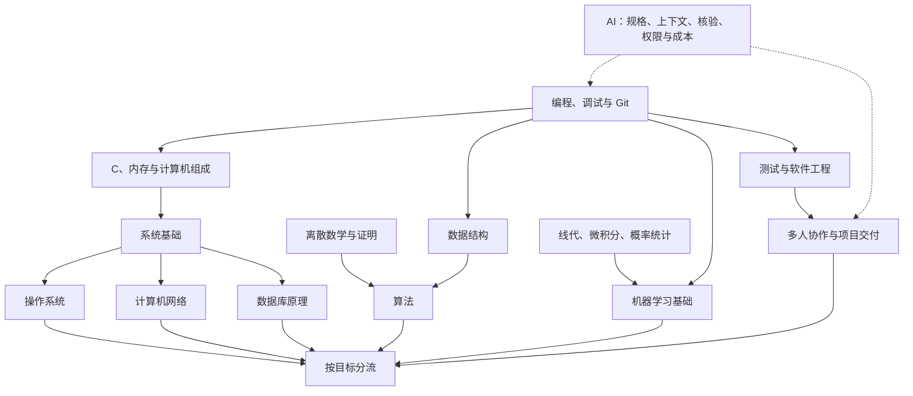

# 四年共同主干：从大一到方向入口

[返回总览](../README.md) · [全部路线](all-routes.md) · [AI 时代修改](ai-era.md)

默认国内四年制计算机本科。校内必修先完成，已经掌握的主题不重复刷课；下面按先修关系组织，而不是规定每所学校的课表。学生只选择一条主线，另一项能力用来补充。

## 先修关系图

箭头表示重要先修关系，不表示必须等所有节点结束才开始分流。数据库使用与网络编程可以先入门，再深入内部机制。

## 八个学期与暑假

| 时间 | 学习主题 | 主资源或选课主题 | 成果与验收 |
| --- | --- | --- | --- |
| 大一上 | 一门语言、函数、控制流、基本数据结构；微积分、线代；工具 | [CS61A](https://cs61a.org/) 或校内编程课；[Missing Semester](https://missing.csail.mit.edu/) | 小程序；能使用调试器解释输入、状态与错误 |
| 大一下 | 数据结构、离散、复杂度；C 与内存；SQL；基础测试 | 校内数据结构/离散；[CS 自学指南对应索引](https://csdiy.wiki/) | 持久化应用；自己实现关键结构，解释复杂度、递归、栈堆 |
| 大一暑假 | 两类方向试学 | 一个面向用户项目＋一个系统/数据/硬件实验 | 记录喜欢的困难、需要的条件和不喜欢的日常工作 |
| 大二上 | 算法、概率统计、组成与系统基础、软件工程 | [CMU 15-213](https://www.cs.cmu.edu/~213/)；校内算法与概率课 | 系统实验；多人代码协作，开始按证据分析性能 |
| 大二下 | OS、网络、数据库；ML 基础认知；方向先修 | [MIT 6.1810](https://pdos.csail.mit.edu/6.1810/)、[CS144](https://cs144.github.io/)、[CMU 15-445](https://15445.courses.cs.cmu.edu/)、[CS229](https://see.stanford.edu/Course/CS229) 按目标选深度 | 核心课与方向项目交错；不要求同学期完整修完四门高负荷公开课 |
| 大二暑假 | 明确主线，尝试开源、实验室或实习 | [路线目录](all-routes.md) | 一份可演示、可解释、可复现的主线作品 |
| 大三上 | 主线进阶、阅读成熟代码或论文 | 对应独立路线的阶段清单与资源 | 代表作第一版，接受审查，独立修复问题 |
| 大三下 | 工程交付或持续研究；准备实习与升学 | 实习/研究目标当年要求 | 工程证据或研究证据，明确个人贡献 |
| 大三暑假 | 实习、研究或真实产品迭代 | 导师、团队、用户或开源社区反馈 | 完成别人真正需要的有边界任务 |
| 大四上 | 对应求职、考试或申请；补弱项 | 目标地区与机构的当年规则 | 简历、作品集与材料真实且一致 |
| 大四下 | 毕设、交接、持续交付；衔接下一阶段 | 主线项目与实际入口 | 别人能运行、评估和继续维护成果 |

不是所有方向都需要把每门课学到内核实现水平。共同基础先建立解释能力，再由主线决定深度。

## 各方向需要的基础深度

“基础”表示能解释和使用；“熟练”表示能独立应用与调试；“深入”表示需理解内部机制、分析或研究。它们是学习建议，不是招聘分数线。

| 主线 | 算法与证明 | 系统与网络 | 数学统计 | 软件工程 | 额外先修 |
| --- | --- | --- | --- | --- | --- |
| 应用软件 | 熟练 | 熟练，按分支加深 | 基础 | 深入实践 | 平台与业务 |
| 系统/云/数据库 | 熟练至深入 | 深入 | 基础至熟练 | 深入实践 | C++、并发、体系结构 |
| 数据分析 | 熟练 | 基础 | 熟练至深入 | 熟练 | 指标与行业理解 |
| AI 应用 | 熟练 | 熟练 | 模型使用所需基础 | 深入实践 | 评测、权限与交付 |
| AI 模型研究 | 熟练至深入 | 熟练 | 深入 | 熟练至深入 | 实验设计与领域数据 |
| AI 系统 | 熟练 | 深入 | 熟练 | 深入实践 | GPU、并行、模型计算 |
| 安全 | 按分支加深 | 深入或专项熟练 | 密码学需深入 | 熟练 | 威胁模型与授权 |
| 硬件/机器人 | 熟练 | 按分支加深 | 熟练至深入 | 熟练 | 电子、控制、物理 |
| 产品/设计/交付 | 基础 | 能沟通技术约束 | 基础至熟练 | 理解交付流程 | 用户研究、写作、业务 |
| 理论/科学研究 | 深入或专项深入 | 按主题 | 深入 | 可复现研究能力 | 对应学科与研究训练 |

## 语言选择

先用一门语言建立编程能力，再接触 C 理解内存。之后按主线选择：应用后端选一条生态，系统通常加 C++ 或 Rust，前端学习 JavaScript/TypeScript，移动端学习对应平台语言，数据与 AI 以 Python 为常见入口。语言多不是验收标准。

## 贯穿四年的 AI 训练

- 学习时先自己形成解题思路，再用 AI 提示、解释和审查；关键实现能独立重做。
- 交付时写清规格、验收与上下文，阅读差异、运行验证、记录工具边界。
- 不提交无法解释的结果；不把生成的引用、依赖和数据当作已核实事实。
- 对执行权限、敏感数据、外部动作和算力设边界。
- 课程作业遵守各自规则。例如不同公开课对 AI 辅助的允许范围并不相同。

实践变化参考 [Missing Semester 2026](https://missing.csail.mit.edu/)；模型与系统的不同先修可比较 [CS336](https://cs336.stanford.edu/) 和 [Deep Learning Systems](https://dlsyscourse.org/)。

## 时间、资源和选择成本

每学期额外集中学习一个主主题并做一个有边界的项目，比同时开启多套完整课程更可执行。具体小时数按校内课业调整，不在这里承诺统一完成时长。

最迟大二结束前协调就业、考研、保研和海外申请的时间窗口；它们不是无限叠加的任务。硬件和前沿模型研究先确认实验条件；领域方向先确认数据、导师或合作机会。

每学期用基础解释、方向实现、外部反馈和下一阶段条件检查进展，见[入口验收](evidence-and-entry.md)。
