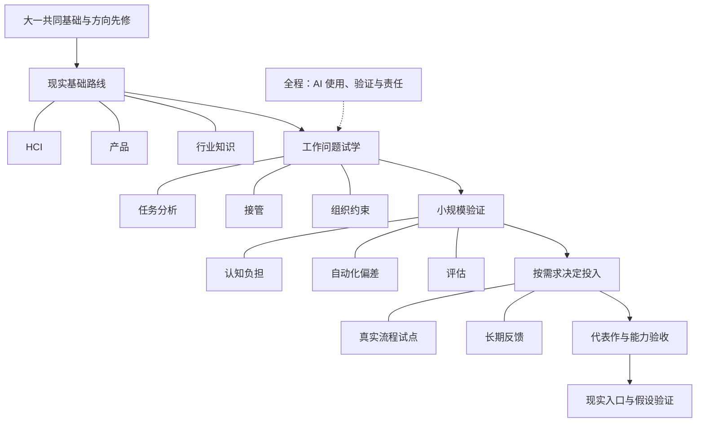

# 人机工作流与岗位重设计

[仓库总览](../../README.md) · [本类目录](../../categories/future.md) · [共同基础](../../docs/foundation.md) · [AI 时代调整](../../docs/ai-era.md)

| 属性 | 说明 |
| --- | --- |
| 路线类型 | 未来假设 |
| 分类 | 未来工作假设 |
| 入口判断 | 已有咨询/HCI 工作，分工可能变化 |
| 观察日期 | 2026-11-21 |
| 规划性质 | 课程顺序、项目与入口判断均为综合建议；不代表统一招聘要求 |

> 这是条件性工作假设。相关技术或研究可能已经存在；这里讨论的是专门分工能否扩大，不宣称岗位尚未存在或未来必然出现。

## 开始前

先掌握本页指定的现实基础能力；这不是已经统一确立的独立岗位培养方案。

先阅读[四年共同主干](../../docs/foundation.md)。已掌握的内容通过习题或项目验收，不重复完整刷课。各分支是可选择的发展方向，不是同一学生的全部必修。

## 节点路线图

实线箭头表示建议阶段顺序；同阶段连接表示知识簇，不表示每个节点都有严格先修关系。虚线表示贯穿能力。

## 阶段学习清单

| 建议窗口 | 课程主题与实践 |
| --- | --- |
| 现实基础路线 | HCI；产品；行业知识 |
| 工作问题试学 | 任务分析；接管；组织约束 |
| 小规模验证 | 认知负担；自动化偏差；评估 |
| 按需求决定投入 | 真实流程试点；长期反馈 |

每个阶段至少留下可检查的代码、实验、分析或设计案例。进度依据掌握程度调整；校内必修、目标院校及岗位当年条件需单独核对。

## AI 时代怎样修改这条路线

**本路线重点：** 验证采用条件、真实问题与经济性；沿现实基础路线积累

| 调整 | 建议 |
| --- | --- |
| 增加 | 验证采用条件、真实问题与经济性；沿现实基础路线积累 |
| 保留并扎实掌握 | 可迁移的系统、数据、研究与协作能力 |
| 减少重复训练 | 追逐未稳定的职位名称；凭趋势预支设备和培训成本 |
| 必须识别的风险 | 已有技术方向不等于新职称；独立岗位与需求规模尚不确定 |

减少重复训练不等于跳过基础。AI 生成的结果仍需由提交者验证；具体课程与工作单位的工具规则优先。上述调整是规划建议，不能推出某个岗位将消失。相关参考：[Anthropic 招聘实例：环境、沙箱、评测与系统](https://www.anthropic.com/careers/jobs)。

## 代表作与能力验收

**项目：** 有人参与的工作流对照实验。

**关键验收：** 测量质量与负担，非仅演示速度。

- [ ] 需求、输入、输出和限制明确。
- [ ] 代码、数据或案例来源清楚，环境与步骤可复现。
- [ ] 记录个人贡献，能脱离 AI 解释关键机制并完成现场修改。
- [ ] 有针对本路线的测试、对照、用户验证或论证。
- [ ] 保留失败案例、误差或限制，而非只展示成功结果。
- [ ] 至少获得一次外部审查：实习、开源、导师、同伴或真实用户反馈。

这是一组能力证据，不是录用保证。具体简历和选拔准备见[求职、升学与作品集](../../docs/evidence-and-entry.md)。

## 后续发展与投入

可延伸到：**现实入口：产品、HCI、咨询**。转向时先补目标路线的先修，不必从所有基础课重来。

未来假设应以实际采用、可测收益和对应招聘为验证条件。优先保留现实岗位入口；若简单方案更优，应缩小投入。

硬件路线先用仿真和学校设备；AI 路线先做小规模正确性实验并设算力预算；行业与研究路线先确认数据、导师或领域资源。不要只按路线名称购买培训或设备。

## 学习资源与依据

以下是起步资源，不是该岗位完整课表。优先选一项主资源并完成练习；目录用于查找与本页主题匹配的课程。课程可访问不表示全部作业、学分或评测免费开放。

| 用途 | 资源 | 类型 |
| --- | --- | --- |
| 岗位存在依据 | [Anthropic 招聘实例：环境、沙箱、评测与系统](https://www.anthropic.com/careers/jobs) | 招聘实例；不能外推需求规模 |
| 补充／专项 | [Anthropic：工作流与智能体设计](https://www.anthropic.com/research/building-effective-agents) | 课程或官方资料 |
| 补充／专项 | [OWASP GenAI Security](https://genai.owasp.org/llm-top-10/) | 课程或官方资料 |

岗位族、课程与未来假设采用不同证据标准，见[来源与方法](../../docs/sources.md)。本页没有采集足以推断地区需求、薪资或录取概率的样本。
