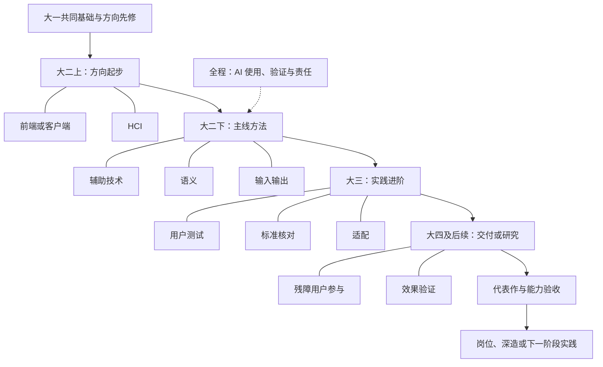

# 无障碍／辅助技术

[仓库总览](../../README.md) · [本类目录](../../categories/research.md) · [共同基础](../../docs/foundation.md) · [AI 时代调整](../../docs/ai-era.md)

| 属性 | 说明 |
| --- | --- |
| 路线类型 | 现有 |
| 分类 | 科研与行业交叉 |
| 入口判断 | 需用户研究与相关标准 |
| 观察日期 | 2026-11-21 |
| 规划性质 | 课程顺序、项目与入口判断均为综合建议；不代表统一招聘要求 |

> 年级只表示本科起步窗口。研究型目标通常还需要持续实验室或研究生训练；这不是统一学历硬门槛，也不承诺四年直接达到研究科学家水平。

## 开始前

共同基础加对应数学与领域课程；研究目标需要持续实验室训练，不能只靠工具教程。

先阅读[四年共同主干](../../docs/foundation.md)。已掌握的内容通过习题或项目验收，不重复完整刷课。各分支是可选择的发展方向，不是同一学生的全部必修。

## 节点路线图

实线箭头表示建议阶段顺序；同阶段连接表示知识簇，不表示每个节点都有严格先修关系。虚线表示贯穿能力。

## 阶段学习清单

| 建议窗口 | 课程主题与实践 |
| --- | --- |
| 大二上：方向起步 | 前端或客户端；HCI |
| 大二下：主线方法 | 辅助技术；语义；输入输出 |
| 大三：实践进阶 | 用户测试；标准核对；适配 |
| 大四及后续：交付或研究 | 残障用户参与；效果验证 |

每个阶段至少留下可检查的代码、实验、分析或设计案例。进度依据掌握程度调整；校内必修、目标院校及岗位当年条件需单独核对。

## AI 时代怎样修改这条路线

**本路线重点：** 增加生成界面与 AI 交互的辅助技术测试；保留真实残障用户参与，不只依赖自动扫描。

| 调整 | 建议 |
| --- | --- |
| 增加 | AI 文献检索核验；辅助实验；数据污染、复现与领域有效性 |
| 保留并扎实掌握 | 数学证明、研究设计、学科基础和独立贡献 |
| 减少重复训练 | 无问题意识的论文收集；重复低价值实验 |
| 必须识别的风险 | 伪造引用；代理指标不等同科学、金融或临床有效性 |

减少重复训练不等于跳过基础。AI 生成的结果仍需由提交者验证；具体课程与工作单位的工具规则优先。上述调整是规划建议，不能推出某个岗位将消失。相关参考：[CS2023 课程框架](https://csed.acm.org/final-report/)。

## 代表作与能力验收

**项目：** 辅助技术可使用的完整流程。

**关键验收：** 真实任务可完成，非只通过扫描。

- [ ] 需求、输入、输出和限制明确。
- [ ] 代码、数据或案例来源清楚，环境与步骤可复现。
- [ ] 记录个人贡献，能脱离 AI 解释关键机制并完成现场修改。
- [ ] 有针对本路线的测试、对照、用户验证或论证。
- [ ] 保留失败案例、误差或限制，而非只展示成功结果。
- [ ] 至少获得一次外部审查：实习、开源、导师、同伴或真实用户反馈。

这是一组能力证据，不是录用保证。具体简历和选拔准备见[求职、升学与作品集](../../docs/evidence-and-entry.md)。

## 后续发展与投入

可延伸到：**UX、设计工程、公益科技**。转向时先补目标路线的先修，不必从所有基础课重来。

本科阶段以初级入口或研究训练为目标；长远职级需要真实经验。

硬件路线先用仿真和学校设备；AI 路线先做小规模正确性实验并设算力预算；行业与研究路线先确认数据、导师或领域资源。不要只按路线名称购买培训或设备。

## 学习资源与依据

以下是起步资源，不是该岗位完整课表。优先选一项主资源并完成练习；目录用于查找与本页主题匹配的课程。课程可访问不表示全部作业、学分或评测免费开放。

| 用途 | 资源 | 类型 |
| --- | --- | --- |
| 基础／起步 | [Nielsen Norman Group：用户研究与可用性资料](https://www.nngroup.com/articles/) | 课程或官方资料 |
| 补充／专项 | [CS2023：人机交互与专业能力框架入口](https://csed.acm.org/final-report/) | 课程或官方资料 |
| 补充／专项 | [Full Stack Open](https://fullstackopen.com/en/) | 课程或官方资料 |

岗位族、课程与未来假设采用不同证据标准，见[来源与方法](../../docs/sources.md)。本页没有采集足以推断地区需求、薪资或录取概率的样本。
