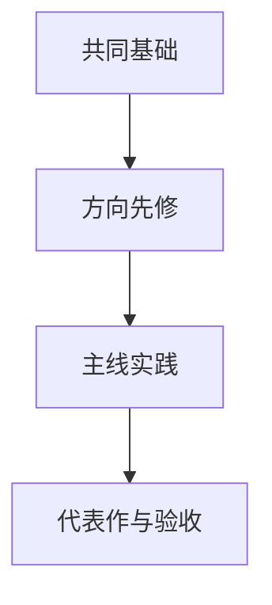

# 路线标题

类型：现有／新兴分工／发展路径／未来假设

观察日期：YYYY-MM-DD

## 入口与先修

说明本科入口、研究延伸或工作经验；给出需要的课程，而非只列工具。

## 节点图

## 阶段清单

| 窗口 | 主题 | 成果 |
| --- | --- | --- |
| | | |

## AI 时代修改

- 增加：
- 保留：
- 减少重复：
- 风险与核验：

## 项目与能力验收

写可检查的标准，不以视频时长或证书数量代替能力。

## 资源与依据

列原始链接、核验日期、适用范围。未来假设另写成立条件、反证信号与现实入口。
